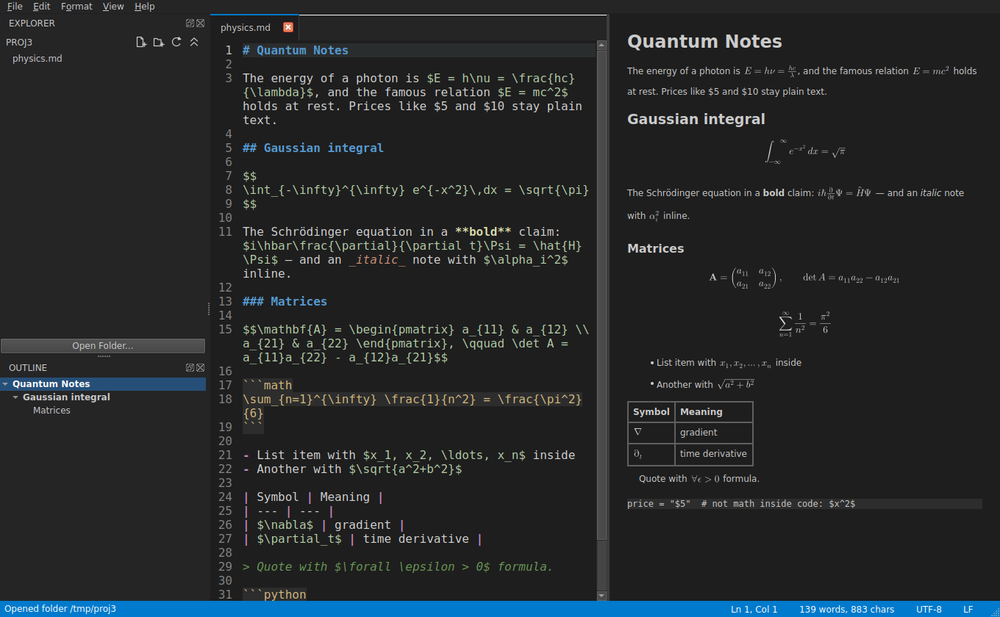

# MD Studio

A VS Code-style Markdown editor written in C++17 with Qt 6 Widgets.



## Features

| Area | What you get |
|------|--------------|
| **Explorer** | Open any folder as a project. Header buttons: **New File**, **New Folder**, **Refresh**, **Collapse All**. New items go into the selected folder (or the project root when nothing is selected); names like `notes/todo.md` create sub-folders. Right-click for Rename, Delete (to Trash), Copy Path, Reveal. |
| **Editor** | Tabs, line numbers, current-line highlight, live Markdown syntax colouring, auto-closing pairs, wrap-selection, list / task / quote auto-continuation, indent / outdent, Find & Replace (regex), Go to line, CRLF/BOM preserved. |
| **Suggestions** | Drop-down list **and** inline grey ghost text. Snippets (`table`, `codeblock`, `link`, `image`, `task`, `frontmatter`, ...) plus words already in the document. **Tab** accepts, **Esc** dismisses, **Ctrl+Space** forces the list. |
| **Preview** | Live rendered preview (GitHub dialect: tables, task lists, strikethrough), synced scrolling, clickable links, double-click a heading to jump to its source. **LaTeX math** (`$..$`, `$$..$$`, `\(..\)`, `\[..\]`, ```` ```math ````) is typeset in the preview and in HTML / PDF / DOCX / ODT exports - see [docs/LATEX.md](docs/LATEX.md). |
| **Outline** | Heading tree that follows the caret. Click to jump in the editor *and* the preview. `Ctrl+Shift+O` = fuzzy "go to heading". |
| **Export** | Built in (no dependencies): **HTML**, **PDF**, **DOCX**, **ODT**, **TXT**. With Pandoc installed: EPUB, LaTeX, RTF, PPTX, RST, AsciiDoc, MediaWiki, Org, Textile... |
| **Settings** | Editor (font, size, tabs, wrap, gutter, suggestions), Appearance (theme), **Preview** (body/code font and size, heading size, line & paragraph spacing, page margin, maximum text width, light/dark preview colours, math on/off and size, reset to defaults), auto-save, Pandoc path, PDF/DOCX page size & margins. |
| **Sidebar** | Explorer and Outline can be stacked or combined into one tabbed group (drag one onto the other, or View > Tabbed Sidebar); the tab switcher is at the **top**. |
| **VS Code feel** | Command Palette `Ctrl+Shift+P`, Quick Open `Ctrl+P`, `Ctrl+Shift+O`, `Ctrl+Shift+E`, session restore, drag & drop files/folders, recent files. |

## Build for Windows (portable, no installer)

**Option A - GitHub Actions (no local setup).** Push this folder to a GitHub repo, open
*Actions -> Build Windows -> Run workflow*. Download `MDStudio-windows-x64.zip` from the run,
unzip anywhere and start `MDStudio.exe`.

**Option B - local.** Install Qt 6 (MinGW 64-bit kit) and run `build-windows.bat`
(edit the two paths at the top). Output: `dist\MDStudio\MDStudio.exe`.

**Option C - Qt Creator.** Open `CMakeLists.txt`, pick a Release kit, build, then run
`windeployqt --release --no-translations MDStudio.exe` next to the exe.

## Build on Linux / macOS

```sh
cmake -S . -B build -G Ninja -DCMAKE_BUILD_TYPE=Release
cmake --build build && ./build/MDStudio [folder-or-files...]
```
(Ubuntu: `sudo apt install qt6-base-dev cmake ninja-build`)

## Key shortcuts

`Ctrl+B` bold, `Ctrl+I` italic, `Ctrl+E` code, `Ctrl+1..4` headings, `Ctrl+Alt+L` link,
`Ctrl+F` / `Ctrl+H` find / replace, `Ctrl+G` go to line, `Ctrl+Shift+V` toggle preview,
`Ctrl+Shift+E` explorer, `Ctrl+,` settings, `Ctrl+Alt+T` toggle theme, `Alt+Z` word wrap.
Everything is also in the menus and the Command Palette.

## Source map

```
src/main.cpp               entry point, command-line files/folders
src/MainWindow.*           application shell: docks, tabs, menus, explorer actions, export dialogs
src/MarkdownEditor.*       editor widget: gutter, auto-pairs, lists, suggestions + ghost text
src/MarkdownHighlighter.*  syntax colouring
src/PreviewView.*          rendered pane (QTextBrowser + Qt's md4c importer)
src/OutlineParser.h        headings parser, front-matter strip, _emphasis_ normaliser
src/MathRenderer.*         LaTeX parser + TeX-style layout engine -> inline images (uses src/MathGlyphData.h)
resources/                 embedded Latin Modern Math font (GUST license) and its Qt resource file
tools/gen_math_glyphs.py   regenerates src/MathGlyphData.h from the font's MATH table
src/Exporter.*             Markdown -> HTML / DOCX / PDF / ODT / TXT / Pandoc
src/ZipWriter.h            minimal ZIP writer used for .docx
src/FindBar.* QuickPick.*  find/replace strip, command-palette style picker
src/SettingsDialog.*       preferences UI;  Settings.* persistence;  Theme.* colours
```

## Notes

* The DOCX/HTML exporters walk Qt's parsed document into a small neutral model
  (`Blk`/`Run` in `Exporter.cpp`), so adding a new built-in format means writing one more emitter.
* Qt's Markdown importer renders `_text_` as underline; `normalizeEmphasis()` rewrites it to `*text*`
  so the preview matches GitHub / VS Code.
* Not included yet: search across files, spell check, Mermaid diagrams, split editors.
